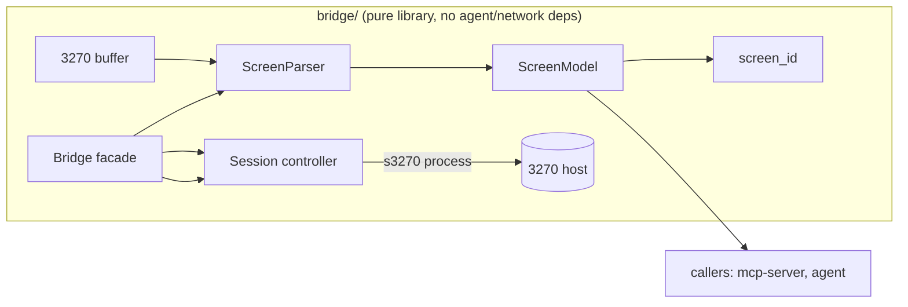

# screen-bridge — Design

## Go/no-go framing
The integration test against a live TK4- session is the project's go/no-go. To de-risk **before** TK4- is available, the design separates two layers:

- **Screen parser** — pure function: 3270 buffer → `ScreenModel`. Fully testable with property-based tests, no emulator needed. Build and harden this first.
- **Session controller** — wraps `s3270` for connect/read/type/press/wait. Only this layer needs TK4-, and only for the integration test.

If the parser's property tests pass and the session integration test connects and reads a stable `screen_id`, the idea works.

## Architecture



- `ScreenParser.parse(buffer_bytes) -> ScreenModel` — pure, deterministic, no I/O.
- `Session` — owns the `s3270` subprocess handle; methods `connect`, `read_buffer`, `send_string`, `press_key`, `wait_unlock`, `disconnect`.
- `Bridge` — public facade combining `Session` + `ScreenParser` into the API the requirements specify (`connect`, `read_screen`, `fill_field`, `press`, `disconnect`).

## Data models (pydantic)

```python
class Field(BaseModel):
    index: int          # 0-based field order
    row: int            # 0-based
    col: int            # 0-based
    length: int         # number of character positions
    protected: bool
    numeric: bool
    hidden: bool        # non-display
    intensified: bool
    value: str | None    # None when hidden (never returned/logged)

class ScreenModel(BaseModel):
    rows: list[str]     # exactly 24 strings, each length 80
    cursor: tuple[int, int]  # (row, col)
    fields: list[Field]
    screen_id: str      # stable hash, ignores unprotected values
```

## screen_id algorithm
`screen_id` must be stable across value changes in unprotected fields (so a screen is recognised again after typing). It is a SHA-256 hex digest of:

1. Every field's **position** (`row`, `col`), **length**, and **attributes** (`protected`, `numeric`, `hidden`, `intensified`).
2. The content of every **protected** character position (the static text/labels that define the screen).
3. Unprotected field **values are excluded**; their positions are included as a length-only placeholder so layout changes are detected, but typed content does not change the id.

This is deterministic and invariant under unprotected-value changes by construction.

## Screen parsing
The 3270 datastream/buffer is a sequence of character bytes interleaved with 3270 orders:
- **SBA** (Set Buffer Address) — moves the write position.
- **SF** (Start Field) — begins a field; the following attribute byte encodes `protected`, `numeric`, `display/hidden`, `intensified`, MDT.
- **SFE** (Start Field Extended) — attribute as keyword/value pairs.
- **IC** (Insert Cursor) — marks cursor position.

The parser:
1. Allocates a 24×80 (1920) buffer initialised to nulls.
2. Walks the orders, tracking the current address and the open field's start + attributes.
3. On `SF`/`SFE`, records the field boundary (the field extends until the next field start or end of buffer).
4. Maps buffer addresses to `(row, col)` via `address = row * 80 + col`.
5. Fills `value` from the buffer, but sets `value = None` and skips recording for `hidden` fields.
6. Reads cursor from `IC`/`s3270` status.

Field attribute decoding (single attribute byte, classic layout):
- protected flag, numeric flag, display field (normal / non-display / intensified), MDT. Exact bit masks are encapsulated in one `attrs_from_byte(b)` helper and unit-tested against known screens.

## Field validation (fill_field)
Before typing into a field via `send_string`:
- Field must exist and be **unprotected** (else `FieldValidationError`).
- `value` length ≤ field `length` (else error).
- If field `numeric` and value contains non-digits (allowing sign/decimal per config) → error.
- `field_ref` resolved: an `int` selects `fields[index]`; a `(row, col)` selects the field covering that position.

## Key press + wait strategy
`press(key)`:
1. Sends the key command (`Enter`, `PF(n)`, `Clear`, `PA(n)`) to `s3270`.
2. Calls `wait_unlock(timeout)`: `s3270` `Wait(t, Unlock)` blocks until the keyboard is unlocked (system available) or timeout.
3. On timeout: do **not** resend the key (ambiguous acknowledgement → fail safely per safety steering); raise `TimeoutError`.
4. Returns `read_screen()` of the resulting screen.

Commit-capable keys (Enter on a data-entry screen, PF keys mapped to update/delete/submit) are flagged as `may_commit=True` in the returned action metadata, so the MCP server/agent can enforce confirmation upstream. The bridge itself does not block.

## Reconnection
- `Session.connect` opens `s3270` and connects to host.
- On a detected dropped session (command returns error / EOF), attempt up to N reconnects with backoff, then raise `SessionError`.

## Property-based testing (Hypothesis)
A **buffer strategy** generates valid 3270 buffers:
- Random 24×80 text in the EBCDIC/ASCII printable range.
- Random `SBA`/`SF` orders placed at valid addresses, with random valid attribute bytes, ensuring fields don't overlap and stay in-bounds.
- Random `IC` cursor position.
- Some fields marked `hidden` with random content.

Invariants asserted for **any** generated buffer:
1. `parse` never raises.
2. Fields never overlap and are within 24×80.
3. `screen_id` is deterministic for the same buffer.
4. `screen_id` is unchanged when only unprotected field values change.
5. No `hidden` field's value appears anywhere in `ScreenModel` output (rows, fields, logs).
6. `rows` is exactly 24 strings of length 80.

## Integration test (against TK4-)
- Marked `@pytest.mark.integration`; skipped if TK4- container not reachable.
- Connect → read the TSO logon screen → assert `screen_id` is stable across two reads → assert at least one unprotected field exists (the user-id field).
- This is the go/no-go gate: if green, proceed to mcp-server.

## Error model
- `SessionError` — connection/dropped session failures.
- `TimeoutError` — wait_unlock expired.
- `AmbiguousAckError` — internal guard, raised instead of re-sending an ambiguous key.
- `FieldValidationError` — fill_field constraint violation.

## Dependencies
`py3270`, `pydantic`, `pytest`, `hypothesis`. `s3270` binary provided by the host image / legacy container (see legacy-environment spec).
