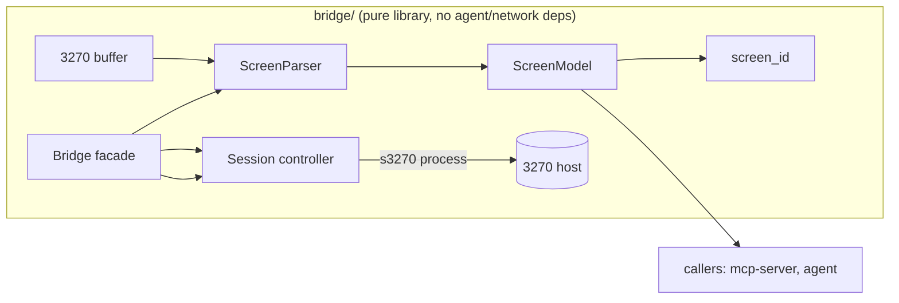

# screen-bridge — Design

## Go/no-go framing
The integration test against a live TK4- session is the project's go/no-go. To de-risk **before** TK4- is available, the design separates two layers:

- **Screen parser** — pure function: 3270 buffer → `ScreenModel`. Fully testable with property-based tests, no emulator needed. Build and harden this first.
- **Session controller** — wraps `s3270` for connect/read/type/press/wait. Only this layer needs TK4-, and only for the integration test.

If the parser's property tests pass and the session integration test connects and reads a stable `screen_id`, the idea works.

## Architecture



- `ScreenParser.parse(buffer_bytes) -> ScreenModel` — pure, deterministic, no I/O.
- `Session` — owns the `s3270` subprocess handle; methods `connect`, `read_buffer`, `send_string`, `press_key`, `wait_unlock`, `disconnect`.
- `Bridge` — public facade combining `Session` + `ScreenParser` into the API the requirements specify (`connect`, `read_screen`, `fill_field`, `press`, `disconnect`).

## Data models (pydantic)

```python
class Field(BaseModel):
    index: int          # 0-based field order
    row: int            # 0-based
    col: int            # 0-based
    length: int         # number of character positions
    protected: bool
    numeric: bool
    hidden: bool        # non-display
    intensified: bool
    value: str | None    # None when hidden (never returned/logged)

class ScreenModel(BaseModel):
    rows: list[str]     # exactly 24 strings, each length 80
    cursor: tuple[int, int]  # (row, col)
    fields: list[Field]
    screen_id: str      # stable hash, ignores unprotected values
```

## screen_id algorithm
`screen_id` must be stable across value changes in unprotected fields (so a screen is recognised again after typing). It is a SHA-256 hex digest of:

1. Every field's **position**, and **attributes** (`protected`, `numeric`, `hidden`, `intensified`). **MDT is not included**: typing into a field sets it, which would change the id.
2. The content of every **protected** character position (the static text/labels that define the screen).
3. Unprotected and hidden field **values are excluded**; their positions are included as a placeholder so layout changes are detected, but typed content does not change the id.
4. **Volatile positions are excluded** (see below).

This is deterministic and invariant under unprotected-value changes by construction. The Hypothesis strategy flips MDT as well as the data when it simulates typing, so a regression here is caught.

### Volatile regions
Some screens carry text that changes without the screen being a different screen (a clock, a date). `Bridge.read_screen()` reads the buffer twice (short gap) and masks every position whose character differs; these are reported in `ScreenModel.volatile` and excluded from `screen_id` but stay visible in `rows`. `diff_positions(a, b)` is the pure helper, property-tested.

Finding from the live TK4- run: the VTAM welcome screen's Date/Time is **stamped at paint time**, not live. Two reads agree, a repaint (e.g. CLEAR) differs. Two-read masking cannot see that, so callers pass known spans via `Bridge(volatile_regions=[(row, col, len)])`; spirit-map is expected to fill these in per screen. Masks are deliberately **not** learned from differences between reads of different screens with the same layout, because that would hide real changes such as list paging.

## Screen parsing
**Design change (review-01):** the bridge does not decode the raw 3270 datastream. The earlier `orders.py`/`attrs.py` encoded the wire format wrongly and were never used, so they were deleted. The only input path is s3270's `ReadBuffer(Ascii)`, which has already done that decoding.

`ReadBuffer(Ascii)` output (each line prefixed `data: `, stripped by `Session._exec`) is one screen row per line. Each token is a hex character code, `SF(c0=nn)` (a field attribute, occupying a position), `SA(...)` (ignored, no position) or `GE(xx)`. `c0` flags: `0x20` protected, `0x10` numeric, `0x0C` non-display, `0x08` intensified, `0x01` MDT (the `0xC0` bits are print bits). The reader is **line-aware**: line N is row N, starting at position `N*80`, so a short or odd line cannot shift later rows. Codes `0xA0–0xFF` map to the same Latin-1 glyph `Ascii()` shows.

The parser (pure, `Buffer -> ScreenModel`):
1. Sorts field starts, de-duplicates positions.
2. A field's data runs from the attribute position + 1 to the next field start or the end of the buffer.
3. Maps positions to `(row, col)` via `pos = row * 80 + col`.
4. Fills `value` from the buffer, but sets `value = None` and blanks the grid for `hidden` fields.
5. Cursor comes from the s3270 status line: fields 8 and 9, **0-origin**, the same base as `MoveCursor(row,col)`.

**Not yet handled (wraparound):** the 3270 buffer is circular, so text before the first field start belongs to the last field. The parser treats it as plain text. Tracked in tasks.md.

## Field validation (fill_field)
Before typing into a field via `send_string`:
- Field must exist and be **unprotected** (else `FieldValidationError`).
- `value` length ≤ field `length` (else error).
- If field `numeric` and value contains non-digits (allowing sign/decimal per config) → error.
- `field_ref` resolved: an `int` selects `fields[index]`; a `(row, col)` selects the field covering that position.

## Key press + wait strategy
`connect()` waits for a stable first screen: `Wait(t,InputField)` (a timeout is not fatal, because the Hercules banner has no input field), then polls `ReadBuffer` until three consecutive reads are identical. TK4- paints the Hercules banner first and moves to the VTAM welcome screen a moment later.

`send_string` uses the quoted form `String("...")`, escaping backslash and double quote, and rejects control characters (a raw newline would inject a second s3270 command).

`press(key)`:
1. Sends the key command (`Enter`, `PF(n)`, `Clear`, `PA(n)`) to `s3270`.
2. Calls `wait_unlock(timeout)`: `s3270` `Wait(t, Unlock)` blocks until the keyboard is unlocked (system available) or timeout.
3. On timeout: do **not** resend the key (ambiguous acknowledgement → fail safely per safety steering); raise `TimeoutError`.
4. Returns `read_screen()` of the resulting screen.

Commit-capable keys (Enter on a data-entry screen, PF keys mapped to update/delete/submit) are flagged as `may_commit=True` in the returned action metadata, so the MCP server/agent can enforce confirmation upstream. The bridge itself does not block.

`COMMIT_CAPABLE` (Enter, PF1–12) is the **safe default**, but it is broad: PF3 (back) and PF7/PF8 (scroll) in ISPF are navigation, and would trigger needless confirmations. **Per-screen override hook (planned):** spirit-map will supply a per-`screen_id` table of keys known to be read-only, which `press()` consults before setting `may_commit`. Until then the broad default stands.

## Reconnection
- `Session.connect` opens `s3270` and connects to host.
- On a detected dropped session (command returns error / EOF), attempt up to N reconnects with backoff, then raise `SessionError`.

## Property-based testing (Hypothesis)
A **buffer strategy** generates valid 3270 buffers:
- Random 24×80 text in the EBCDIC/ASCII printable range.
- Random `SBA`/`SF` orders placed at valid addresses, with random valid attribute bytes, ensuring fields don't overlap and stay in-bounds.
- Random `IC` cursor position.
- Some fields marked `hidden` with random content.

Invariants asserted for **any** generated buffer:
1. `parse` never raises.
2. Fields never overlap and are within 24×80.
3. `screen_id` is deterministic for the same buffer.
4. `screen_id` is unchanged when only unprotected field values change.
5. No `hidden` field's value appears anywhere in `ScreenModel` output (rows, fields, logs).
6. `rows` is exactly 24 strings of length 80.

## Integration test (against TK4-)
- Marked `@pytest.mark.integration`; skipped if TK4- container not reachable.
- Connect → reach the VTAM welcome screen (CLEAR if the banner is still up) → assert `screen_id` is stable across two reads → assert `Logon ===>` is at row 22, col 0 → assert the 0-origin cursor `(22, 11)` lies in an unprotected field → compare every parsed row with s3270's own `Ascii()` row. A misaligned parse fails this.
- A second test shows the clock stamp changes across a repaint (unmasked ids differ) and that masking its region keeps `screen_id` stable.
- This is the go/no-go gate: if green, proceed to mcp-server.

## Error model
- `SessionError` — connection/dropped session failures.
- `TimeoutError` — wait_unlock expired.
- `AmbiguousAckError` — internal guard, raised instead of re-sending an ambiguous key.
- `FieldValidationError` — fill_field constraint violation.

## Dependencies
`py3270`, `pydantic`, `pytest`, `hypothesis`. `s3270` binary provided by the host image / legacy container (see legacy-environment spec).
