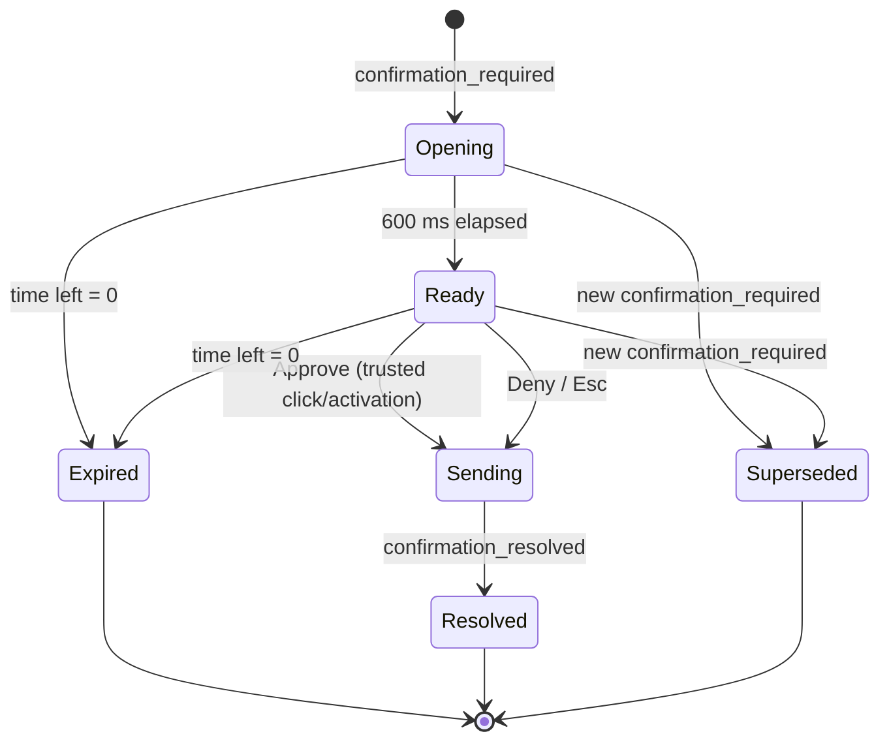

# seance-ui — Design

## Shape
A single-page React + Vite + TypeScript app. One pure reducer holds all state; a `Transport` interface feeds it events; components render state. There is no other source of truth, which is what makes the app testable with generated event sequences and runnable against recorded transcripts before the agent exists.

```mermaid
flowchart LR
    subgraph transports
      WS[WebSocketTransport<br/>hello, resume, backoff]
      MOCK[ReplayTransport<br/>transcripts jsonl]
    end
    WS --> R[reducer.ts<br/>pure: (state, event) -> state]
    MOCK --> R
    R --> ST[(AppState)]
    ST --> V[views]
    V -- "user_message, confirm_decision, connect_system, cancel_turn" --> TX[Transport.send]
    REST[REST client<br/>apps, spirit-map, audit] --> ST
    ST --> PL[PlanchetteScheduler<br/>pure queue + animation driver]
    ST --> GEO[geometry.ts<br/>row,col <-> rect]
```

`web/` talks only to the agent (HTTP + websocket). It does not import any Python package or know about the 3270 session.

## Stack
React 18, Vite, TypeScript (strict), Vitest, Testing Library, `vitest-axe`, `fast-check` (property tests), `dagre` (graph layout). State in plain React context + `useReducer`; no Redux. All versions pinned exactly. New to the stack versus `tech.md`: `fast-check`, `vitest-axe`, `dagre` and Testing Library; each exists to satisfy a requirement here (property tests, a11y tests, deterministic graph layout). To confirm with the user before the first `npm install`.

## Layout
```
web/
  package.json, vite.config.ts, tsconfig.json, index.html
  A11Y.md                         # manual accessibility record
  src/
    main.tsx, App.tsx
    config.ts                     # VITE_AGENT_URL, VITE_MODE (live|mock)
    strings.ts                    # all user-visible text
    protocol/
      types.ts                    # TS types mirroring contracts section 3 and 4
      guards.ts                   # runtime validation of incoming events
      transport.ts                # Transport interface
      wsTransport.ts
      replayTransport.ts
    state/
      reducer.ts, selectors.ts, store.tsx
    terminal/
      Grid.tsx, Row.tsx, FieldSpan.tsx, Oia.tsx, geometry.ts, ScreenAsText.tsx
    planchette/
      Planchette.tsx, scheduler.ts, gestures.ts
    chat/
      Chat.tsx, Composer.tsx, Message.tsx, StepCard.tsx, SafeText.tsx
    connect/
      ConnectScreen.tsx, SystemCard.tsx
    map/
      SpiritMap.tsx, layout.ts, MapTable.tsx, NodePreview.tsx
    audit/
      AuditDrawer.tsx
    confirm/
      ConfirmModal.tsx, useFocusTrap.ts
    a11y/
      Announcer.tsx, SkipLinks.tsx, useReducedMotion.ts
    styles/
      tokens.css, crt.css, layout.css
  test/
    arbitraries.ts                # fast-check generators for events
    ...
```

## State
```ts
type AppState = {
  session: { id: string | null; lastSeq: number; state: SessionState; readOnly: boolean;
             llm: { provider: string; model: string; available: boolean }; appId: string | null };
  screen: { screenId: string; rows: string[]; fields: FieldOut[]; cursor: [number, number] } | null;
  messages: Message[];            // user, assistant (with step cards), system
  turns: Record<TurnId, TurnState>;
  focusQueue: FieldFocus[];       // consumed by the planchette scheduler
  confirmation: Confirmation | null;   // at most one
  audit: AuditEntry[]; auditChain: { ok: boolean; brokenSeq: number | null };
  map: SpiritMapView | null; currentNodeId: string | null;
  connection: 'connecting' | 'open' | 'reconnecting' | 'closed'; observerOnly: boolean;
  ui: { effects: 'full'|'low'|'off'; reduceMotion: boolean; drawerOpen: boolean; tab: ... };
}
```
Reducer rules (all property-tested):
- Events with `seq <= lastSeq` are ignored; a gap triggers a `hello` with `resume_from`; a new `session_id` resets everything except UI preferences.
- `confirmation_required` replaces any open confirmation (the old one is marked superseded in the message log).
- `confirmation_resolved` for an id that is not open is recorded in the log and otherwise ignored.
- `currentNodeId` = map node whose `screen_id` equals `screen.screenId`, else `null` -> the "uncharted" state.
- No reducer branch reads or stores a hidden value. Hidden fields arrive with `value: null`.

## The grid
`geometry.ts` is pure and the only place with numbers:
```
cell(row, col) -> {x: col * 1ch, y: row * lineHeight, w: 1ch, h: lineHeight}
fieldRect(field) -> union of cells over [col, col+length) on one row (wraps to next rows if length crosses 80)
```
Rows render as `<div role="row">`-less plain divs with a fixed `height: calc(var(--line) * 1)`; each row is split into `<span>` runs by field boundaries so a field is one element with data attributes. Row components are memoised on their `rows[i]` string plus the fields on that row, so a screen update re-renders only changed rows. The planchette reads `fieldRect` and positions itself by CSS transform inside the same coordinate space, so it is exact at any zoom.

Scaling: the grid is `80ch` wide; a container query scales font size to fit the pane while keeping an aspect-correct cell (3270 cells are roughly 1:2). Minimum font size stays above readability limits; below that the pane scrolls horizontally rather than shrinking text.

Hidden fields: cells are rendered as spaces (the server already sends blanks); a `data-hidden` attribute draws a faint inset marker. The value is not in the DOM in any form.

## Planchette
`scheduler.ts` is pure: `schedule(queue, now, reduceMotion) -> {current, next, dropped}`.
- Order is preserved; when more than 5 are queued, all but the last become `dropped` (instant moves).
- `reduceMotion` -> every target is `instant: true`.
- Duration is a function of distance (400 to 700 ms, ease-out), gesture from `mode`.
`Planchette.tsx` animates a CSS transform (Web Animations API) and listens to `finish`. It renders an SVG lens with a transparent centre and a small label ("reading Policy number") visible to sighted users; the label is `aria-hidden` because the same text is announced from the chat's live region.

The gesture set is small: `read` = slow horizontal sweep across `fieldRect`; `fill` = settle then expanding ring; `key` = move to the key bar under the grid and pulse the key name. No gesture covers text for longer than 700 ms.

## CRT styling
Design tokens in `tokens.css`:
```
--bg: #020a04;  --phosphor: #3dff7a;  --phosphor-dim: #29b857;  --phosphor-bright: #c9ffd9;
--field-fill: rgba(61,255,122,.10);  --danger: #ff8f6b;  --warn: #ffd166;  --focus: #ffffff;
```
Contrast to be measured and recorded in `A11Y.md` (target: phosphor on bg well above 7:1; dim >= 4.5:1; focus ring >= 3:1 on every surface). Scanlines: a `repeating-linear-gradient` overlay at low alpha with `mix-blend-mode` avoided (it can reduce contrast unpredictably); vignette by radial gradient; glow by `text-shadow` at `Full`/`Low`, none at `Off`. Flicker and sweep are `@keyframes` guarded by `@media (prefers-reduced-motion: no-preference)` and by the in-app toggle (`data-motion="reduce"` on `<html>`).

Effects are a pure presentation layer on a separate overlay element, so turning them off cannot change layout or text.

## Spirit-map view
`layout.ts` runs `dagre` on `SpiritMapView` (rankdir LR, fixed node size) and returns positions; the same input always gives the same output (tested). `SpiritMap.tsx` renders SVG: nodes as rounded rects with name and kind icon, edges as paths with the key label; a read-only edge is solid, a frontier/denied/commit edge is dashed with a lock glyph and the word "needs confirmation" or "not explored" in its label. The current node has a thick outline plus a "you are here" text tag. During a tool run, `field_focus`/`screen` events extend a highlighted path with a short trail (instant under reduced motion). `MapTable.tsx` is the accessible equivalent and is shown in the same tab (collapsible, open by default for screen reader users via a settings flag and always reachable by a visible toggle).

## Audit drawer
Initial load from `GET /api/audit?limit=500`; then appended by `audit_entry` events (de-duplicated by `seq`). Virtualised list above 500 rows. The chain badge shows `chain_ok` from the REST response and flips to "unknown" (not "ok") after live appends until a refresh, because the UI cannot verify hashes itself and must not pretend to.

## Confirmation modal

Authoritative block (from the event's gate fields): key keycap, mini-screen with highlighted fields, field list `label: value`, countdown, read-only banner. Separate block: "The agent says (unverified)" with `agent_summary` as plain text. Initial focus: Deny. Approve is `disabled` for 600 ms with a visible countdown ring; `onClick` checks `event.isTrusted`. Time left is computed from `expires_in_s` and the local receipt time (a monotonic clock), not from server wall-clock. The dialog is rendered through a portal with `inert` applied to the app root. On `read_only` the Approve button is replaced by an explanation and the dialog only offers Close (which sends Deny so the pending action does not linger).

## Accessibility architecture
- **Landmarks:** `header` (system name, state, toggles), `main` containing the terminal region, `aside` (chat), `nav` (tabs), plus the audit drawer as a `complementary` region.
- **Live regions:** one `Announcer` component owns two regions (polite, assertive); all announcements go through it, rate-limited (1/s polite). Chat itself is `role="log"`.
- **Terminal region:** `role="region"` `aria-label="3270 screen, <screen name or 'uncharted'>"`. Rows are text; field spans carry `aria-label` ("Policy number, input, 8 characters"). `ScreenAsText` produces a linear alternative.
- **Focus:** the grid is not a tab stop (it is not interactive); the splitter, tabs, composer, toggles, drawer and modal are. `useFocusTrap` is written once and tested.
- **Contrast:** tokens checked by a Vitest test that computes WCAG contrast for each text/background token pair at every effects level (pure arithmetic, so it runs in jsdom).
- **Motion:** `useReducedMotion` merges the OS media query and the in-app toggle; every animation reads it.

## Replay transport
`ReplayTransport` implements `Transport`, loads a transcript, and emits events with their recorded relative timing (scaled by `VITE_REPLAY_SPEED`). It also reacts to `connect_system`, `user_message` and `confirm_decision` by advancing to the next scripted segment, so a UI developer can click through "lookup", "commit with approval", "deny", "injection screen" and "session lost" without any backend. The OIA line shows `REPLAY`.

## Testing approach
- **Reducer (fast-check):** arbitraries in `test/arbitraries.ts` build valid event sequences by construction (a small generative grammar: session, optional connect, turns containing tool calls/results, optional confirmations resolved in any allowed way) and then mutate them (duplicate, delay within window, reconnect with new session id). Invariants as in REQ-026.
- **Geometry (fast-check):** round-trip and containment (REQ-026).
- **Scheduler (fast-check):** REQ-027.
- **Components:** Testing Library with the real reducer and a fake transport; `vitest-axe` for each state.
- **Modal safety:** user-event with trusted events versus `dispatchEvent(new MouseEvent('click'))` (untrusted) to prove the `isTrusted` check.
- **Contrast:** arithmetic test over tokens.
- jsdom has no layout, so pixel positions are checked through `geometry.ts`, not through DOM measurements; real rendering is checked in the manual pass and screenshots.

## Risks
| Risk | Mitigation |
|---|---|
| UI is built before the agent exists | `ReplayTransport` and committed transcripts; conformance tests on both sides. |
| Planchette alignment drifts across fonts/zoom | One coordinate space (`ch` and line-height units, transform inside the grid container); geometry tested in isolation; manual check at 100/200%. |
| Glow/scanlines hurt contrast or cause discomfort | Effects are an overlay with levels; contrast measured at each level; reduced-motion default is quiet. |
| Approving by habit | Deny default focus, 600 ms delay, gate-sourced content, unverified agent text, `isTrusted`. |
| Graph unreadable for screen readers | Table equivalent is first-class. |
| New dependencies (`fast-check`, `vitest-axe`, `dagre`) | Pinned; each tied to a requirement; confirm with user before install. |
| Claiming WCAG conformance | Only "designed to meet"; manual record in `A11Y.md`. |
