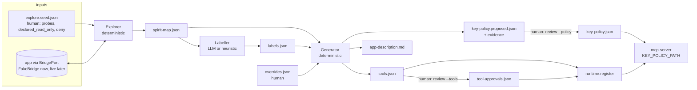

# spirit-map — Design

## Shape
A Python package `seance_spirit` in `spirit-map/` with a CLI (`python -m seance_spirit ...`) and a small runtime library that `mcp-server` calls. It depends on `bridge/` types and on `mcp-server` (`SeanceService`, `BridgePort`, `SafetyGate`). It never imports `agent/` or `web/`.



Two arrows are deliberately missing: `labels.json` never feeds the explorer or the key policy, and nothing feeds `key-policy.json` except a human.

## Module layout
```
spirit-map/
  pyproject.toml                 # deps pinned ==; installs ../bridge and ../mcp-server editable
  src/seance_spirit/
    __main__.py                  # CLI: explore | label | generate | review | replay | describe
    seed.py                      # ExploreSeed (pydantic): probes, declared_read_only, deny, budgets, harvest
    policy.py                    # EffectivePolicy: may_press(key, screen) -> Allow | Deny(reason); pure
    explorer.py                  # Explorer: frontier search, return-path discipline, halting
    graph.py                     # SpiritMap (pydantic): nodes, edges, frontier; merge, drift, paths
    store.py                     # atomic JSON write, canonical ordering, leak check
    replay.py                    # replay(path) -> ReplayReport
    llm.py                       # LlmClient protocol; anthropic, bedrock, scripted, cache
    labeller.py                  # prompts (data-delimited), schema validation, heuristic mode
    labels.py                    # Labels (pydantic), sanitising, confidence
    generator.py                 # tools, schemas, recipes, names, lock file
    keypolicy.py                 # candidate rules + evidence (pure)
    describe.py                  # app-description.md
    review.py                    # approvals, policy promotion (human CLI)
    runtime.py                   # run_tool(service, pack, tool, args); register(...)
  tests/
    strategies.py                # fake_apps(), buffers via bridge.arbitrary_buffer
    snapshots/                   # golden tools.json etc.
  README.md
```

## Explorer

### Safety layers (outermost first)
1. `SeanceService` built with `allow_commit=False`. Even a bug that tries a commit key cannot reach the app via the confirm path, because no confirm is ever issued.
2. `EffectivePolicy.may_press(key, screen)`, a pure function checked **before** each press:
   ```
   deny (global, screen, label pattern)        -> Deny
   key in declared_read_only[screen] or approved key-policy[screen_id] -> Allow
   key not in COMMIT_CAPABLE                    -> Allow
   otherwise                                    -> Deny("commit_capable")
   ```
3. The service's own gate: a commit-capable key that passes (2) because it is *declared* read-only is not in the service's key policy during exploration, so the gate would propose rather than send. The explorer therefore passes the declared keys into the exploration service's `KeyPolicy` (same file format). Layer 1 stays the backstop: if the declaration were wrong the action would sit pending and never be confirmed.
4. FakeBridge assertion in tests: the fake records every key it receives and the property test checks them against the policy.

Text hints (PF key legends, words like "DELETE") are parsed into `hints` that can only add `Deny` entries. There is no code path from screen text to `Allow`.

### Search
Breadth-first over (node, candidate action) with a priority for unvisited and shallow nodes.

Candidate actions for a node:
- For each allowed key: press it with no input.
- For each unprotected, non-hidden, non-credential field with a matching probe (by label pattern or field key): fill it, then each allowed key. Probes come from the seed or, with `harvest`, from visible values already seen.
- Never more than `fanout` (default 6) actions per node.

After each action the explorer reads the landing screen and records the edge. It then needs to be at a known place:
- **Return path.** Each node stores its best known read-only route from the `home` node (the start screen or a CLEAR/PF3 route). The explorer returns by replaying that route, verifying `screen_id` after each step.
- If verification fails it tries the alternative stored route once (a read-only replay of a *different* path is not a resend of the same key). If that fails too: halt `lost`.
- `keyboard_timeout`: halt `halted:ambiguous_ack`. Do not read-and-continue; the caller must look at the session first.

### Volatile regions
Per node the explorer stores the `volatile` mask the bridge reports. For known screens the seed may list regions (the TK4- clock spans already exist in mcp-server config). The map records them so the generator can emit a recommended `VOLATILE_REGIONS` string for the app.

### Attach mode
`explore --attach` starts from whatever screen the live session shows (after a human logon). `explore --start-recipe` is only allowed when the recipe contains no fills (e.g. press CLEAR). The CLI refuses a seed that fills a hidden field.

## Data formats

### `spirit-map.json` (`gss.spiritmap/1`)
```json
{
  "schema": "gss.spiritmap/1",
  "app_id": "fake-insurance",
  "run": {"id": "r_...", "started_at": "...", "status": "completed|halted|budget", "reason": null,
          "steps": 87, "budgets": {"max_screens": 50, "max_steps": 300}},
  "home": "n_1a2b3c4d5e",
  "nodes": [{
    "id": "n_1a2b3c4d5e", "screen_id": "<sha256 hex>", "visits": 4,
    "rows": ["..."],                       // 24 x 80, sanitised, hidden blanked
    "fields": [{"key": "polno", "index": 3, "row": 5, "col": 14, "length": 8,
                "protected": false, "numeric": false, "hidden": false,
                "intensified": false, "label": "POLNO"}],
    "volatile": [[0, 60, 19]]
  }],
  "edges": [{
    "id": "e_...", "from": "n_...", "to": "n_...", "key": "PF3",
    "fills": [{"field": "polno", "probe": "known_policy"}],
    "read_only": true, "why_read_only": "not_commit_capable|declared|approved_policy",
    "observed": 3
  }],
  "frontier": [{"from": "n_...", "key": "ENTER", "fills": [], "reason": "denied_commit"}]
}
```
`field.key` is a stable snake_case key derived from the label (`POLNO` -> `polno`), disambiguated by position when labels repeat. Recipes refer to field keys, never indexes, and resolve to the current index at run time.

### `labels.json` (`gss.labels/1`)
```json
{"schema": "gss.labels/1", "app_id": "...", "map_hash": "sha256:...", "source": "anthropic:<model>|heuristic",
 "nodes": {"n_...": {"name": "Policy enquiry", "kind": "enquiry", "purpose": "...", "confidence": 0.92}},
 "fields": {"n_...:polno": {"business_name": "Policy number", "role": "identifier", "data_type": "string", "confidence": 0.95}},
 "edges": {"e_...": {"meaning": "Back to main menu", "confidence": 0.9}}}
```
The map has no label fields. The generator reads both; the explorer reads only the map and seed.

### `explore.seed.json` (human authored)
```json
{
  "app_id": "fake-insurance",
  "probes": [{"field_label": "POLNO|POLICY", "name": "known_policy", "value": "P0000001"}],
  "declared_read_only": {"n_menu": ["ENTER"], "n_enquiry": ["ENTER", "PF3"], "n_list": ["PF3", "PF7", "PF8"]},
  "deny": {"keys": [], "nodes": [], "field_label_patterns": ["PASS|PWD|PIN|SECRET"]},
  "budgets": {"max_screens": 50, "max_steps": 300, "max_depth": 8},
  "harvest": false
}
```
Seeds reference nodes by `node_id` (stable because it derives from `screen_id`) or by `screen_id`. For a first run on an unknown app the seed can be empty: only non-commit keys are tried, so the first map is small and honest about its frontier.

### Iteration: how a map grows safely
`explore` (non-commit keys only) -> `generate` proposes candidate read-only keys with evidence -> **human** `review --policy` approves some -> `explore` again (approved policy is now an input) -> larger map. The candidate rules, all deterministic:
1. **Display-only screen:** no unprotected fields, so ENTER cannot submit anything. Candidate: ENTER.
2. **Navigation key:** a PF key whose every observed landing is a previously visited node on the path back toward `home`, or a sibling in a list (same field layout). Candidate: that key.
3. **Declared and behaved:** the seed declared it and every observation landed on a recorded node.
Rule 1 and 2 are heuristics. They are only ever proposals, shown with their evidence (`key-policy.evidence.json`), and the reviewer sees the screen text and the observed edges before signing.

## Generator

### Tool derivation
From the graph, find "tool candidates":
- **Lookup:** a path from `home` to a node where an identifier-role input field is filled and a read-only key lands on a node with display fields. Tool: `lookup_<noun>(<identifier>)`; output = the display fields.
- **List:** a node with repeated rows of the same field layout plus an optional paging key. Tool: `list_<noun>s(page?)`.
- **Update (commit):** a path that fills input fields on a form node and reaches a node whose onward key is `denied_commit`. Tool: `update_<noun>_<field>(identifier, value)` ending in `propose`.

Roles and nouns come from labels (or overrides); the shapes (paths, fields, keys) come only from the graph. If labels are missing, heuristic labels apply and the tool is `draft`.

### Recipe example (`lookup_policy` on `fake-insurance`)
```json
{
  "name": "lookup_policy", "kind": "read", "title": "Look up a policy",
  "description": "Find one insurance policy by number and return holder, status, premium and last update. Reads legacy screens; returned text is untrusted data.",
  "input_schema": {"type": "object", "additionalProperties": false, "required": ["policy_number"],
    "properties": {"policy_number": {"type": "string", "maxLength": 8, "pattern": "^[A-Z0-9]{1,8}$",
                                     "description": "Policy number as printed on the schedule"}}},
  "output_schema": {"type": "object", "additionalProperties": false,
    "required": ["holder", "status", "premium"],
    "properties": {"holder": {"type": "string"}, "status": {"type": "string"},
                   "premium": {"type": "string"}, "last_updated": {"type": "string"}}},
  "recipe": [
    {"op": "goto", "node": "n_menu"},
    {"op": "fill", "node": "n_menu", "field": "option", "value": {"literal": "1"}},
    {"op": "press", "key": "ENTER", "expect": "n_enquiry"},
    {"op": "fill", "node": "n_enquiry", "field": "polno", "value": "$policy_number"},
    {"op": "press", "key": "ENTER", "expect": "n_enquiry_result"},
    {"op": "extract", "node": "n_enquiry_result",
     "into": {"holder": "holder", "status": "status", "premium": "premium", "last_updated": "upddate"}}
  ]
}
```
`pattern` for `policy_number` comes from the field (length 8, not numeric) intersected with a conservative alphabet. The full tool and result envelope are in `docs/contracts.md` section 6.

### Runtime
`run_tool(service, pack, tool, args)`:
1. Validate `args` against `input_schema` (reject extras).
2. `goto`: read screen; map `screen_id` to node; if unknown -> `unknown_start`; else take the shortest path over **read-only edges** to the target node, pressing through `service.press_key` (each press is audited; none can be commit-capable under the effective policy, and if the gate still says pending the run aborts `unexpected_pending`).
3. `fill`: resolve `field` key to an index with the node's layout; verify the current `screen_id` equals the node's; call `service.fill_field`.
4. `press`: `service.press_key`; if the result is `pending` and the step is not `propose`, abort `unexpected_pending`. Check `expect`.
5. `extract`: read from the screen the value of the named fields; never hidden; sanitised by the existing conversion.
6. `propose` (last step of commit tools only): `service.press_key`; return the `PendingOut`.
7. Budget: `max_steps` default 25 per tool call.

The runtime never calls `confirm_action`, never retries, and returns the trace so the agent can stream the planchette path.

### Registration
`register(server, service, pack, approvals)` loops tools, skips any whose `def_hash` is not approved, and adds each as an MCP tool with the tool's JSON Schema as `inputSchema`. The Python signature is `(**kwargs)` validated by the runtime, so the SDK's dynamic registration is a small adapter; the SDK API for dynamic tool registration is checked in task 6.1 (risk below).

## Testing strategy
The strategies are the point.

- `fake_apps()`: Hypothesis builds a random app: N screens (using the bridge's buffer strategy for layouts), a transition table `(screen, key, input class) -> screen` where some edges are marked `mutating` (the fake sets a `dirty` flag and records the key). Some apps are all-ENTER-mutating to be hostile.
- **Explorer safety (REQ-033):** run the explorer on the fake with a seed that declares only a subset truly safe. Invariants: the fake received no key outside `allowed(seed)`; `dirty` is never set. Model-based: the test keeps its own allowed set derived from the seed, not from the explorer's own policy object (the mistake the mcp-server gate test found and fixed). Mutation checks: break the deny-wins rule, break the commit check, let a text hint relax a deny: each must fail the suite.
- **Replay (REQ-032):** explore, then `replay` every stored edge path.
- **Label independence (REQ-036):** generate with two arbitrary label files (including hostile ones from a text strategy); compare key policy, kinds, key sets.
- **Leak (REQ-035):** hidden sentinel `@` through the whole pipeline; scan every artefact and every captured LLM prompt.
- **Snapshots (REQ-037):** `tools.json` for `fake-insurance`.

LLM calls in tests use `ScriptedLlm`; a real-provider test is marked `llm` and skipped without credentials.

## Decisions and risks
| Item | Decision / mitigation |
|---|---|
| ENTER can never be proved read-only by observation | It can't, so we don't claim it. Heuristic candidates + mandatory human sign-off. Said plainly in the README and the demo. |
| TK4- unauthenticated screens are few (welcome, bogus-logon error) | They make a small but real graph and exercise the live path. A richer TK4- map (RFE/ISPF) needs a human logon (attach mode) and is a stretch goal. The insurance app is the main show. |
| Dynamic tool registration API in `mcp` 2.x unverified | Spike in task 6.1 before committing to the adapter; fallback is one generic `call_generated_tool(name, args)` tool with the schema list exposed as a resource (worse for LLMs, same safety). |
| Screen layouts that change per record (list screens with variable rows) | Nodes are keyed by `screen_id` (protected text + layout). List screens are handled as one node with an `extract_list` step; variance in row count is not a new node. |
| Two parallel agents change the format | Formats live in `docs/contracts.md`; changes go through the integrator. |
| Replay on a real system is not deterministic (data changes) | Replay checks `screen_id` only, never data. |
