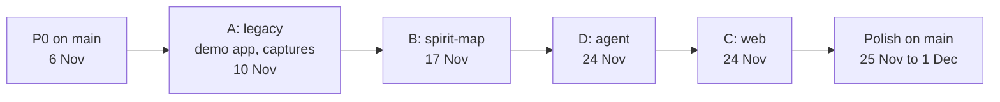

# Parallel plan — Green Screen Seance

**Status:** draft for review, 2026-11-04. Nothing here has been started.
**Read first:** `docs/contracts.md` (ownership, protocol, live-container rule). This plan says who works where, in what order work lands, and when.

Assumptions to confirm: the hard deadline is not in the repo; this plan treats **Tue 1 Dec 2026** as the last working day. Dates are the milestones you gave.

---

## 1. Who does what

| Agent | Spec | Folder | Branch | Worktree (suggested) |
|---|---|---|---|---|
| **A** legacy | `legacy-environment` (open tasks 3.5 to 8) | `legacy/` | `agent/a-legacy` | `D:\Kiro\gss-wt\a\Kiroween26` |
| **B** spirit-map | `spirit-map` | `spirit-map/`, `docs/spirit-map/` | `agent/b-spirit-map` | `D:\Kiro\gss-wt\b\Kiroween26` |
| **C** web | `seance-ui` | `web/` | `agent/c-seance-ui` | `D:\Kiro\gss-wt\c\Kiroween26` |
| **D** agent | `seance-agent` | `agent/` | `agent/d-seance-agent` | `D:\Kiro\gss-wt\d\Kiroween26` |
| **Integrator** (you / main session) | contracts, `bridge/`, `mcp-server/`, merges | everything shared | `main`, `integration` | the current checkout |

Proposed mapping to Kiro tools (a proposal, not a constraint):
- **A: a Kiro IDE session.** Needs interactive TSO and console work and Docker, and A is the only one allowed to touch the container. Dogfooding option: use the `green-screen-seance` MCP server to run KFIX over 3270 (legacy-environment 3.5-followup).
- **B: Kiro Crew.** Long, deterministic, test-heavy work with a clear spec; the property tests give it a built-in definition of done.
- **D: Kiro IDE sub-agent or Crew.** Backend with many small safety tests.
- **C: Kiro IDE sub-agent or Crew.** Benefits from visual review; you will want to look at screenshots daily.

Caveat to verify before starting: Kiro IDE sub-agents run inside one workspace folder. If they share a working tree, branch isolation is lost. Give each agent its own worktree and open that folder as its workspace (or set its working directory to it) and check with `git branch --show-current` in the first command it runs. For Crew, confirm how it assigns a working directory. Do not start anyone until this is confirmed.

---

## 2. Branches and worktrees

```powershell
# from D:\Kiro\Kiroween26 (main checkout), after P0 is merged and tagged
git tag contracts-v1
New-Item -ItemType Directory -Force D:\Kiro\gss-wt | Out-Null
foreach ($a in 'a-legacy','b-spirit-map','c-seance-ui','d-seance-agent') {
  $letter = $a.Substring(0,1)
  git worktree add "D:\Kiro\gss-wt\$letter\Kiroween26" -b "agent/$a" contracts-v1
}
git worktree add D:\Kiro\gss-wt\int\Kiroween26 -b integration contracts-v1
```

Per-worktree setup (each is a separate directory):
- Python venvs are per folder (`bridge/.venv`, `mcp-server/.venv`, ...). Each agent creates its own; do not share venvs between worktrees.
- `.tools/` (s3270, gitignored) is not in a new worktree. Copy it from the main checkout into **A's and the integration worktree only**; others use FakeBridge and do not need s3270.
- `.env` files are gitignored and not copied. Only A's worktree gets `legacy/.env`. Only A's worktree gets the marker file `.gss-live-ok` (contracts 2.1). No one else sets `GSS_LIVE_OK`.
- `.kiro/settings/mcp.json` points the Kiro-side `green-screen-seance` server at the live container. In B, C and D sessions do not call its `connect` (the live guard in P0 also refuses it without the marker).

Branch rules:
- Work only on your branch. Push your branch (`git push -u origin agent/<name>`); never push to `main`.
- **Start every day with `git merge main`** into your branch (no rebasing of pushed branches, no force-push).
- Small commits, one per task, message `<component>: <task id> <what>` (as in the mcp-server history).
- The ownership check (P0 script `scripts/check-ownership.ps1`) must pass before a PR: it lists changed paths against the branch's allowed paths from contracts section 1.

---

## 3. P0: integrator work before anyone branches (target Fri 6 Nov)

These are the shared prerequisites other agents' specs name as "blocked until done". They are mine/yours (integrator) because they touch `bridge/`, `mcp-server/` and shared docs. Each is small, additive, and keeps the existing mcp-server tests green.

| # | Item | Why | Needed by |
|---|---|---|---|
| P0.1 | Promote `FakePort` to `seance_mcp.fake`; add `FakeApp` (value-aware transitions, key log, `dirty` flag, `from_capture`) and `fake_insurance()` per contracts section 10 | B, D need a fake app that behaves; today it is in `mcp-server/tests` and ignores values | B, D, C(mock data) |
| P0.2 | `build_service(settings, port, audit_path) -> (MCPServer, SeanceService)` factory | D hosts the server in-process | D |
| P0.3 | `SafetyGate.deny_oob(action_id, who)` (audited `rejected`) and wiring so `oob` approve/deny are reachable from Python | the UI's Deny; today only `approve_oob` exists and nothing calls it | D |
| P0.4 | `SeanceService.observe(cb)` step events and `AuditLog.subscribe(cb)` | live `field_focus`/`screen`/`audit_entry` streaming | D |
| P0.5 | Tool-pack hook in `server.py`: `GENERATED_TOOLS_PATH`, `tool-approvals.json` check, calls `seance_spirit.register` if present; `SEANCE_ALLOW_UNREVIEWED_TOOLS` | B's output must reach the MCP server | B, D |
| P0.6 | Live guard: `connect` to a non-fake host refuses (`live_not_allowed`) unless `GSS_LIVE_OK=1` or marker file `.gss-live-ok` exists in the repo root | enforces contracts 2.1 mechanically | everyone |
| P0.7 | `docs/contracts/examples/`: event JSON, seven transcripts, REST responses, a tool pack, a key policy, a capture, `SpiritMapView`; plus JSON Schemas generated from the Pydantic models | shared test fixtures for C and D | C, D |
| P0.8 | `scripts/check-ownership.ps1` and `scripts/gate.ps1` (runs each component's tests that exist) | merge gates | all |
| P0.9 | `.gitattributes` (`docs/kiro-journal.md merge=union`), `.gitignore` (`.gss-live-ok`, `docs/audit/`, `agent/.env`, `web/node_modules`), update `structure.md` with `spirit-map/`, point the journal hook at `docs/handoff/<letter>/journal.md` when `GSS_AGENT` is set | avoid merge conflicts | all |
| P0.10 | User decisions (section 9): new web dev dependencies, KICKS fallback rule, Kiro tooling per agent | unblock C and A | C, A |

P0 exit: all existing tests pass (`bridge`, `mcp-server`), new tests for P0.1 to P0.6 pass, `contracts-v1` tag pushed.

---

## 4. Merge order



Why this order:
1. **P0** first because everything imports it.
2. **A** next. It touches only `legacy/`, so it cannot conflict, and it delivers the real screens and the captures the others test against.
3. **B** before D because the agent's business-first behaviour needs the tool-pack runtime. D can start earlier on a two-tool stub (D's task 5.3) and swaps to B's real pack when B merges.
4. **D** before C for the live connection, though C starts earlier on transcripts and mock mode.
5. **C** last because it only depends on the contract; it merges with the live backend already present.

Rolling integration: the `integration` branch merges every green agent branch weekly (Sunday 8, 15, 22 Nov) so that incompatibilities show up early, not on 24 Nov. The integrator runs `scripts/gate.ps1` on it and writes `docs/handoff/integrator/status-<date>.md` (what merged, what failed, who owes what).

Merge gate for a PR to `main` (all required):
1. `check-ownership.ps1` passes (no foreign paths).
2. The component's own tests pass; property tests are run with a fixed `--hypothesis-seed` in the gate and with random seeds in a second run; frontend `vitest --run`.
3. `mypy` clean where practical (tech.md) for Python; `tsc --noEmit` clean for web.
4. Contract conformance: examples validate against the models (section 11 of contracts).
5. Safety review: for `agent/`, `spirit-map/`, `mcp-server/` the existing safety-review hook output is attached or the change is reviewed against mainframe-safety by the integrator. A PR that adds a commit path without confirmation does not merge.
6. No secrets, no `.env`, pinned dependencies, `.kiro/` untouched except the owner's spec folder.

Conflict hot spots and how they are handled: `docs/kiro-journal.md` (union merge, agents write to their own `docs/handoff/<letter>/journal.md`), `.gitignore` and root `README.md` (integrator only), `mcp-server/` (integrator only; requests go through `docs/handoff`).

---

## 5. Timeline

Today is Wed 4 Nov.

| Date | Integrator | A legacy | B spirit-map | D agent | C web |
|---|---|---|---|---|---|
| Wed 4 to Fri 6 Nov | docs review with you; P0.1 to P0.9; tag `contracts-v1` | read specs; plan KICKS retry | read | read | read |
| Sat 7 | create worktrees; confirm agent tooling | KICKS 3.5 attempt 4 (`PROFILE PREFIX`, or interactive KFIX via our MCP server) | scaffold, policy first (tasks 1, 2) | scaffold, events (1, 2) | scaffold, protocol types (1) |
| **Sun 8** | **integration checkpoint 0; KICKS go/no-go with you** | go/no-go report | graph/store | session, ring buffer | reducer + property tests |
| Mon 9 | | KICKS or fallback path | explorer on fake | tools, mapper | geometry, scheduler |
| **Tue 10 Nov: demo app** | merge A | **5 screens reachable through the bridge; reset script; health check; captures of all 5 screens** | explorer + replay property tests green on fake | confirm broker + state machine | grid + OIA rendering in mock mode |
| Wed 11 to Fri 13 | wire hand-written key policy for fake/real screens (mcp-server 6.3) if B is late | tk4 captures (`legacy/captures/tk4-*`); seed/reset hardening | labelling (heuristic, scripted LLM, cache), injection test | agent loop with scripted LLM; injection test (obedient model) | planchette, CRT effects, chat |
| Sat 14 to **Sun 15** | **integration checkpoint 1** | run B's live TK4- exploration on request | generator, key-policy candidates, snapshots | API, origin/token, WS tests | connect screen, states, step cards |
| Mon 16 | | | runtime + registration (spike result in design.md); review CLI | Anthropic/Bedrock providers | modal + safety tests |
| **Tue 17 Nov: spirit-map** | merge B; wire `KEY_POLICY_PATH` and tool pack in mcp-server; close mcp-server 6.3 | live exploration of `tk4-builtins` run and committed; KICKS app exploration (stretch) | **explore -> label -> generate -> review -> runtime works end to end on `fake-insurance`; tk4-builtins map committed; golden policy matches** | swap stub for real pack | audit drawer, spirit-map view |
| Wed 18 to Fri 20 | | demo data reset x3 | maintenance, KICKS app run | live-model injection test, `llm_unavailable` | accessibility suite, reduced motion |
| Sat 21 to **Sun 22** | **integration checkpoint 2** (D + C together on `integration`) | | support | integration fixes | integration fixes |
| Mon 23 | | live run of agent E2E #1 (on request) | | | |
| **Tue 24 Nov: agent and UI** | merge D, then C; tag `m3-agent-ui` | live E2E (scripted provider) once | | **chat -> tools -> planchette -> modal -> audit working in the browser on `fake-insurance`; real provider works; live path attempted by A** | **same, plus automated a11y green, A11Y.md started** |
| Wed 25 | polish starts on `main`; bug triage list | demo path x3 live (record) | docs + support spirit-map UI fixes | fixes from live runs | visual polish |
| Thu 26 | | | | | manual accessibility pass (NVDA, keyboard-only, zoom, reduced-motion) |
| Fri 27 | | live run #2 | | robustness (session loss, timeouts) | screenshots for journal |
| Sat 28 | docs: root README, journal merge | | | | spec-vs-vibe experiment (audit drawer) |
| Sun 29 | demo script and recording prep | live run #3 | | | |
| Mon 30 | **feature freeze**; final gate; demo path three times in a row (A runs it) | | | | |
| **Tue 1 Dec** | buffer, submission write-up, tag `v1.0` | | | | |

Hard rules for the dates:
- A milestone is met only when its acceptance (right column of that row) is demonstrated, not when code exists.
- Anything not done by a milestone is cut or moved by decision on the next checkpoint, not silently carried.
- From 25 Nov only bug fixes, polish and docs; new capability needs the integrator's yes.

---

## 6. Dependencies between agents

| Needs | From | By | If late |
|---|---|---|---|
| `FakeApp`, `fake_insurance`, factory, observers, `deny_oob`, tool-pack hook | Integrator (P0) | Fri 6 Nov | everyone is blocked; this is the critical path of week one |
| 5 real screens + captures | A | Tue 10 Nov | B and D use `fake_insurance` (already enough); real screens swap in later |
| Tool pack runtime + `key-policy.json` | B | Tue 17 Nov | D uses the stub tools; integrator ships the hand-written golden policy |
| Event examples/transcripts | Integrator (P0.7) | Fri 6 Nov | C builds the transport against the table in contracts section 4 and fixes up when examples land |
| REST + WS service | D | Sun 15 Nov (scripted provider) | C stays in mock mode |
| Live runs on `gss-legacy` | A, on request | continuous | live test results are late but nobody else is blocked |

---

## 7. Risks and decision points

| Risk | Impact | Mitigation / decision |
|---|---|---|
| **KICKS install stays blocked** (legacy-environment 3.5, two attempts; third patched but failed on missing `PROFILE PREFIX`) | no real demo app by 10 Nov | **Decision with you on Sun 8 Nov.** Order: (1) one more attempt with `PROFILE PREFIX(HERC01)`, or interactive KFIX through our own MCP server; (2) research a TK4- full-screen alternative; (3) a small Python TN3270 server in docker serving the same five screens, labelled honestly as a stand-in. The pipeline, agent and UI work unchanged on any of them because they run on `fake_insurance` and captures. |
| P0 slips | all four agents blocked | P0 has priority over everything else for the integrator; items are ordered by who needs them (P0.1 to P0.4 first) |
| Contract drift between D and C | integration pain on 24 Nov | shared examples, conformance tests both sides, weekly integration checkpoints, only the integrator edits the contract |
| A agent touches the live container | corrupted demo state | live guard (P0.6), marker file only in A's worktree, ownership check, plan section 2 |
| Sub-agents share one working tree | branch isolation lost | verify per section 1 before starting |
| Dynamic tool registration in `mcp` 2.x does not work as hoped | B's runtime delayed | spike on 16 Nov at the latest (B task 6.1); fallback is one generic `call_generated_tool` with schemas as a resource |
| UI polish eats the time needed for a11y evidence | weak criterion 3 | a11y automated tests run from the first component; manual pass fixed on 26 Nov |
| LLM provider access or quota | agent untestable with real models | `scripted` provider is first-class; real-provider tests are marked and optional; one recorded real transcript per provider |
| Safety regressions while moving fast | breaks the project's thesis | property tests (stateful gate, explorer safety, no-unconfirmed-commit in the agent) are in the merge gate; mutation checks recorded in tasks |
| The demo must work three times in a row | | A's reset script and health check (legacy 7.x); the three runs are scheduled on 25, 27 and 29 Nov and again on 30 Nov |

---

## 8. Definition of done per milestone

**10 Nov, demo app:** menu, enquiry, list, update, confirm reachable through the bridge from a cold start; `reset-data` restores 8 seed policies; `healthcheck` passes; captures of all five screens in `legacy/captures/seance-insurance/`; README walkthrough. (Or the agreed fallback, labelled.)

**17 Nov, spirit-map:** on `fake-insurance`: `explore` yields the 5-screen map with a recorded frontier; replay property test green; labelling (heuristic and scripted LLM) green; `tools.json` snapshot committed with `lookup_policy`, `list_policies`, `update_policy`; approved policy equals the golden table; runtime executes the tools on `FakeApp`; update ends pending and the fake saw no commit key; `tk4-builtins` map committed from a live run by A; mcp-server 6.3 closed; journal entry written.

**24 Nov, agent and UI:** in a browser on `fake-insurance`: ask "look up policy P0000003" -> planchette moves, answer appears; ask "set its premium to 300" -> modal -> Deny leaves data unchanged, Approve changes it; audit drawer shows the whole sequence; spirit-map view highlights the current screen; injection fixture does not make the agent do anything; all protocol examples validate on both sides; automated a11y green; reduced motion respected; a live run through the same stack has been done once by A.

**1 Dec, release:** three consecutive successful live demo runs (recorded); manual a11y record complete or its gaps stated; README, journal and write-up done; spec-vs-vibe paragraph written; all `.kiro/` committed; no secrets.

---

## 9. Decisions needed from you

1. **Approve `docs/contracts.md`** (especially: the in-process agent with oob approval, the human-approved key policy rule, the ownership of `bridge/` and `mcp-server/` by the integrator, and the live-container marker file).
2. **New web dev dependencies:** `fast-check`, `vitest-axe`, `dagre`, Testing Library (needed for the property-based and accessibility requirements). `tech.md` lists only Vitest today.
3. **Tooling per agent** (section 1) and how Kiro Crew assigns working directories.
4. **KICKS fallback rule** for 8 Nov (section 7).
5. **Deadline:** confirm 1 Dec as the last working day.
6. Who is the integrator on days you are away (merge gate, live runs): if it is only you, the schedule has a single point of failure.

---

## 10. Write-up hooks (judging criterion 2 and 5)

- Kiro Crew (bonus): record what worked and what conflicted in `docs/handoff/<letter>/journal.md`: worktree isolation, contract changes mid-flight, merge friction, live-container contention.
- Each agent logs one dated surprise per milestone. The integrator merges them into `docs/kiro-journal.md`.
- Screenshots: connect screen, planchette mid-glide, confirmation modal, graph, audit drawer (C); first labelled map and generated tools (B); the obedient-model injection test passing (D).
- Re-run Kiro's own elicitation test with `SEANCE_ALLOW_COMMIT=1` before the recording (open item from mcp-server 6.4).
